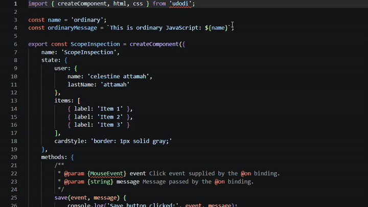

# Udodi for VS Code

Official Visual Studio Code support for [Udodi](https://udodi.dev) — the lightweight, zero-dependency JavaScript UI framework.

Udodi for Visual Studio Code brings a dedicated editing experience to Udodi templates so you can write, navigate, and understand components directly inside your JavaScript and TypeScript files.

## See it in action

*Editing an Udodi component with template highlighting, IntelliSense, and language support.*

## Features

- **Template support:** Syntax highlighting and CSS language features inside Udodi `html` and `css` tagged templates.
- **IntelliSense:** Context-aware completions for directives, events, component members, nested properties, and `@for` variables.
- **Code navigation:** Hover information, Go to Definition, Peek Definition, Rename, and Find All References for supported component symbols.
- **Diagnostics:** Static checks for common template and component errors.
- **Directive and loop awareness:** Support for Udodi directives, event modifiers, and `@for` item and index scopes.

## Supported languages

- JavaScript (`.js`)
- JavaScript React (`.jsx`)
- TypeScript (`.ts`)
- TypeScript React (`.tsx`)

## Installation

1. Open Visual Studio Code.
2. Open the Extensions view (`Ctrl+Shift+X` / `Cmd+Shift+X`).
3. Search for **Udodi**.
4. Select the extension published by **udodi-js**.
5. Click **Install**.

To install a local build, run `npm ci` and `npm run package`, then use **Install from VSIX…** in the Extensions view.

## Requirements

- Visual Studio Code `^1.145.0`
- JavaScript or TypeScript host documents
- [Udodi](https://udodi.dev) for building reactive UIs (runtime is separate from this extension)

## Compatibility and limitations

Analysis is static and limited to same-file declarations the extension can read. It supports object-literal state (including nested objects), simple initializers, and array or return shapes it can infer. It does not resolve imported or cross-file symbols, dynamic expressions, or STDLIB helpers to their runtime implementations. Nested property *names* (for example only `name` in `user.name`) are not renamed as independent symbols; root members and `@for` variables are. Diagnostics are best-effort and do not replace Udodi runtime validation.

## Documentation

- [Udodi documentation](https://udodi.dev)
- [Getting started](https://udodi.dev/guide/)
- [Udodi GitHub](https://github.com/udodi-js/udodi)
- [Extension repository](https://github.com/udodi-js/udodi-vscode)

## Issues and contributions

- [Report an issue](https://github.com/udodi-js/udodi-vscode/issues)
- [Contribute on GitHub](https://github.com/udodi-js/udodi-vscode)

See [docs/architecture.md](https://github.com/udodi-js/udodi-vscode/blob/main/docs/architecture.md) for the grammar and language-server design, and [docs/testing.md](https://github.com/udodi-js/udodi-vscode/blob/main/docs/testing.md) for automated and manual test notes.

## License

[MIT](https://github.com/udodi-js/udodi-vscode/blob/main/LICENSE)
